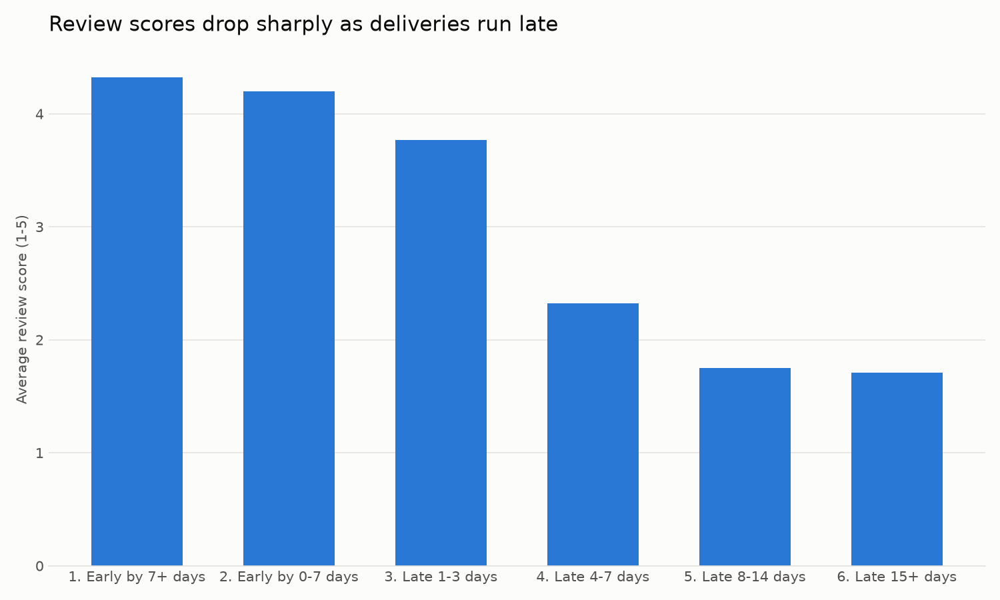
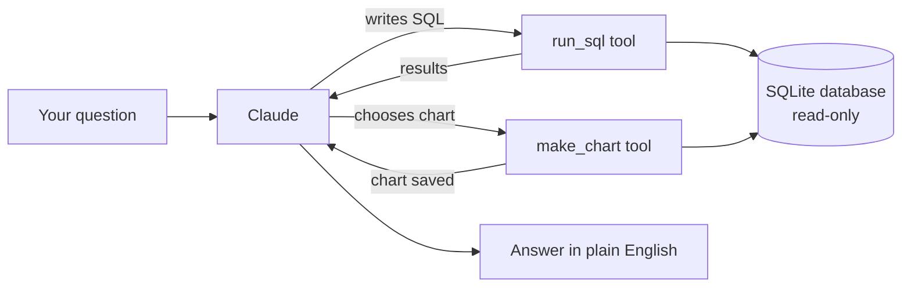
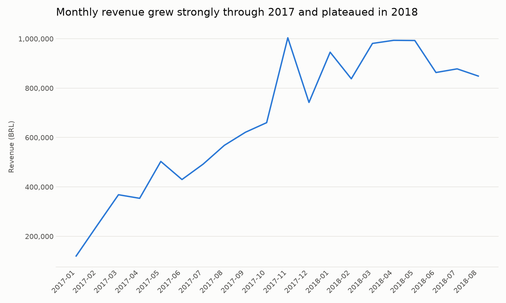

# Data Analyst Agent

An AI agent that answers business questions about an e-commerce database in plain English. It writes its own SQL, runs it, makes charts, and explains the results.

Built in Python with the Claude API, SQLite and pandas.



---

## What it does

You ask a question in plain English:

```
You: Do late deliveries get worse review scores?
  [step 1] run_sql: SELECT CASE WHEN o.order_delivered_customer_date > o.order_estimated_delivery_date ...
  [step 1] run_sql: SELECT CASE WHEN d<=0 THEN '0 on time/early' WHEN d<=3 THEN '1-3 days late' ...

Agent: Yes. Late deliveries get much worse review scores.
       On-time orders average 4.29 out of 5. Late orders average 2.57,
       and more than half of late orders get a 1-2 star review.
```

The agent decides which queries to run, runs them on the database, reads the results and writes the answer. It can also answer with a chart.

## How it works



The agent is a loop: Claude chooses a tool, my Python code runs it, the result goes back to Claude, and this repeats until Claude has enough to answer.

| Tool | What it does |
|---|---|
| `run_sql` | Runs a SELECT query and returns up to 50 rows |
| `make_chart` | Runs a query and draws a bar, horizontal bar or line chart |

**Safety and reliability:**
- The database is opened **read-only**, so the agent cannot change or delete data.
- SQL errors are sent back to Claude, so the agent **fixes its own queries**.
- The loop stops after 10 steps, so it can never run forever.
- Claude never writes drawing code. It only chooses the data and chart type, and my code draws the chart, so every chart is safe and consistent.

## The data

The [Brazilian E-Commerce Public Dataset by Olist](https://www.kaggle.com/datasets/olistbr/brazilian-ecommerce) from Kaggle: 9 related tables and about 1.55 million rows, covering roughly 99,000 orders from 2016 to 2018. Money amounts are in Brazilian reais (BRL).

## Evaluation: how accurate is it?

I built a test set of 15 questions. Each one has an answer key: my own SQL query that calculates the correct answer. A script (`evaluate.py`) asks the agent every question and grades the answers automatically.

The questions come in four levels:
- **Easy (6):** simple counts and averages
- **Medium (5):** totals, dates and grouping
- **Hard (2):** joins across several tables
- **Tricky (2):** traps a careless analyst would fall into

### Results

| Model | Instructions | Score |
|---|---|---|
| Claude Sonnet | basic | **15/15** (run twice, same result) |
| Claude Haiku | basic | **14/15** |
| Claude Haiku | with one note about the data | **15/15** |

### What I learned

**1. A valid query can still give the wrong answer.** Haiku answered "How many unique customers have placed orders?" with 99,441. In this dataset, every order gets a new `customer_id`, even when the same person orders again. The real number of people comes from `customer_unique_id`: 96,096. The query ran without errors and looked correct, which makes this the most dangerous kind of mistake.

**2. Better context can replace a bigger model.** After I added one line to the agent's instructions explaining the difference between the two customer columns, the smaller, cheaper and faster model scored 15/15, the same as the larger model. Documenting your data well has real value.

**3. A perfect score needs a critical look.** Many test questions spell out exactly what to calculate, which makes them easier than real business questions. The fix for Haiku was also tested on the same question it originally got wrong. The next step is a set of new, vaguer questions the agent has never seen.

## Another finding: catching misleading charts

The first monthly revenue chart showed revenue crashing to zero at the end. That wasn't real: the dataset simply stops in late 2018, so the last months contain only a handful of orders. I added a rule to the agent's instructions: *for trends over time, check the number of orders per period and leave out incomplete periods*. The corrected chart:



The agent now leaves out incomplete months by itself.

## Run it yourself

1. Download the Olist dataset from Kaggle and put the CSV files in a folder called `data`.
2. Set up the project:
   ```bash
   python -m venv .venv
   source .venv/bin/activate        # Windows: .venv\Scripts\activate
   pip install -r requirements.txt
   python build_db.py               # turns the CSV files into ecommerce.db
   ```
3. Create a file called `.env` with your Anthropic API key:
   ```
   ANTHROPIC_API_KEY=your-key-here
   ```
4. Ask questions:
   ```bash
   python agent.py
   ```
5. Run the evaluation:
   ```bash
   python evaluate.py                                          # default model
   AGENT_MODEL=claude-haiku-4-5-20251001 python evaluate.py    # a different model
   ```

## Project structure

```
├── agent.py            # the agent: tools, instructions and the agent loop
├── build_db.py         # loads the Kaggle CSV files into SQLite
├── eval_questions.py   # 15 test questions with SQL answer keys
├── evaluate.py         # asks the agent every question and grades the answers
├── eval_results_*.csv  # saved results of each evaluation run
├── charts/             # charts made by the agent
└── images/             # charts used in this README
```

## Next steps

- New, vaguer test questions (for example "Who are our best customers?"), where the agent should ask what is meant instead of guessing
- A simple web interface with Streamlit
- A web search tool, so the agent can combine the database with outside information

---

**Fabio Boila**, data analyst student at Hyper Island, Stockholm
